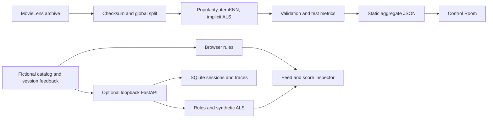

# Architecture

The browser and API share catalog and replay fixtures. Browser recommendations score all eligible clips using prior exposure, selected interests, demonstrated genre affinity, and an exploration bonus. Greedy post-ranking penalizes genres already represented in the partial list. Frozen comparisons use explicit candidate IDs. The displayed final score sums the exact trace contributions for that decision. The score is a ranking value without probabilistic calibration.

API ALS fits seeded fictional interactions and folds positive session signals into the fixed item factors. The collaborative contribution is derived from the clipped dot product. It has a rules fallback when the session has insufficient positive feedback. MovieLens artifacts are generated offline and are never loaded from a request or user upload. NumPy loads application-generated arrays with pickle disabled. The historical model comparison is independent of synthetic clip ranking.

## Local API boundaries

The API creates an opaque 256-bit capability for each fictional session and stores only its hash. Trace, event, and reset operations scope queries to that capability. Validated event IDs make retries idempotent, with a conflict for a mismatched payload reusing an ID. Request bodies, feedback histories, recommendation count, rate, and stored traces are bounded. Expired sessions are deleted when a new session opens. SQLite with transactional writes supports the intended single-node demo. The API is served on loopback by default, and its CORS allowlist contains the local web origins. The demo has no analytics or third-party playback dependencies. A hosted multi-user deployment requires managed identity, HTTPS, a persistence strategy, and distributed rate limits.

Request schemas are in `packages/contracts`. The API returns current candidate IDs, removal reasons, final ordering, model version, and score contributions. The browser can export the exact replay policies, events, results, and metrics as JSON.
