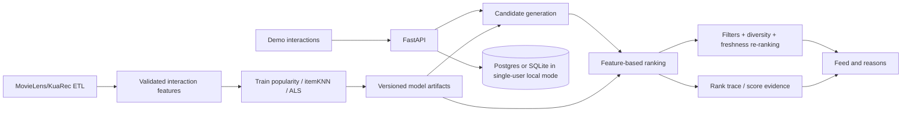

# Project 02 — FeedCraft: Explainable Short-Video & Streaming Recommendation Lab

**Working name, not trademark cleared.** **PRD version:** 1.0. **Status:** build specification / not implemented.<br>
**One-line pitch:** A recommendation system visitors can **use and inspect**: as they watch, skip, like and change preferences, an actual ranking engine adapts and reveals what drove each recommendation and what trade-offs it made.<br>
**Target roles:** ML engineer, recommender systems engineer, AI product manager, full-stack engineer, UX/product designer.<br>
**Primary user:** viewer looking for relevant and diverse content. **Secondary user:** recommender engineer/product manager evaluating engagement vs novelty, coverage and quality.

## A. Competitive reality and differentiator

YouTube, TikTok and Netflix have proprietary, large-scale recommendation systems; this project is **not** an implementation of their internal algorithms. Research reference is multi-stage candidate generation + ranking + post-ranking. RecBole provides many established recommendation baselines; two-tower retrieval is a recognized architecture. Differentiation is **inspectable user control, model evidence, feedback-loop simulation, rigorous offline evaluation and an attractive feed**, not claiming a new SOTA ranking algorithm.

**Do not:** scrape YouTube/TikTok/Netflix account data, use copyrighted streaming assets without license, imitate login/auth screens, train on fake engagement then claim external predictive accuracy, claim an offline nDCG increase guarantees real-world retention uplift, or fabricate a live recommendation model when showing recorded results.

## B. User journeys

### Viewer
1. Enter demo as one of three fictional profiles (genre-focused, discovery-oriented, new cold-start user) or start with no profile.
2. Onboarding: opt into interests/genres, select familiar content categories, content intensity and explore-vs-familiar preference.
3. Scroll feed of legally usable thumbnails/sample clips; click play/pause, finish, skip, like/dislike, save and hide topic; all interactions update local demo state.
4. After a minimum number of interactions, press *Refresh for You* to request a **real API or local deterministic reranking**. Show new feed and explain what's changed.
5. Open **Why this?** for each item: previous tags/items driving score, model family, novelty/diversity factors, and uncertainty/cold-start fallback. Never expose private data belonging to another viewer.
6. Toggle *More exploration* and see how top-K changes; compare ordering with same candidate pool and record ranking differences.
7. Reset demo/profile and reproduce the initial ranking.

### ML/product analyst
1. Open Control Room: dataset version, train/eval run, model, offline metrics, confidence/variance caveats.
2. Compare popularity vs item-item collaborative filtering vs ALS (and optional sequential model) on **identical temporal splits**.
3. Open model trace: candidate set size, retrieval source, filter removals, ranking features, final scores, re-ranking adjustments.
4. Simulate a session or opt-in traffic replay, inspect diversity, coverage, relevance and popularity distribution. Mark synthetic simulator output separately from real historical dataset evaluation.
5. Change exploration and repetition constraints; evaluate quality and performance; export JSON experiment card.

## C. Sitemap, UX and visual identity

| Route | UI | P0 interaction |
|---|---|---|
| `/` | Landing + demo chooser | launch persona, inspect mode, model status |
| `/feed` | Short-video discovery | swipe/scroll, play licensed clip, like, skip, save, reason tooltip |
| `/watch/[item]` | Streaming detail | categories, metadata, related recommendations, history |
| `/profile` | Preference controls | interests, content filters, exploration slider, reset |
| `/why/[request]` | Rank debugger | waterfall score breakdown; retrieve/rank/re-rank trace |
| `/lab/models` | Model comparison | metrics, baselines, eval methods, chosen model |
| `/lab/simulator` | Session simulator | replay seeded session, compare ranking policies |
| `/lab/evaluation` | Evaluation report | dataset splits, metrics, data bias/limits, charts |

**Distinct design:** high-energy editorial cinema/mobile content discovery—not a generic table-heavy ML dashboard. Black/stone background, pale subtitle, restrained vivid tangerine accent; tall media cards, tactile vertical navigation; Control Room as a contrasting technical lab with small precise typography and diagrams. Desktop split layout (feed + rank inspector) while mobile prioritizes a real touch-first feed. Include pause on hidden tab, motion-reduced transition, captions/audio controls, keyboard alternatives, accessible descriptions and explicit simulated footage labels.

**Signature interaction:** user watches/skips → backend emits normalized event → candidate retrieval + ranker + diversity re-ranker produces updated feed → **explainable score waterfall**; user can freeze candidate set and move exploration slider to see precise ranking trade-offs.

## D. P0/P1/P2

**P0:** curated legally usable demo media; three profiles incl cold start; on-page recorded demo or live deterministic baseline when backend absent; real backend train/eval with MovieLens 100K or 1M; popularity, itemKNN and implicit ALS; candidate generation + ranking + deterministic rule filters + diversity; interaction collection; session-sensitive personalization from user feedback; `why this` fact reasons; full reproducible temporal evaluation; rank inspector; responsive, fast local API; static public demo; testing.

**P1:** pairwise preference editing, exploratory policy slider, counterfactual-simulator *with explicit synthetic assumptions*, experiment reports, simple contextual bandit in simulator only, exposure logging, metric CI, recommender model registry.

**P2:** two-tower neural retrieval, sequential transformer (SASRec/GRU4Rec) after baselines; approximate nearest-neighbor index and online A/B experimentation with consented real participants; multi-objective creator fairness/satisfaction. Defer distributed vector services, GPUs, Kafka, model orchestration platforms until required by measured load.

**Out of scope:** real TikTok/YouTube/Netflix integration, streaming licensed commercial video, real ad tracking, production personalized advertising, claims of causal engagement uplift from offline tests.

## E. Data decision and evaluation rigor

### Data modes

1. **MovieLens** (official GroupLens source): start small (100K then 1M), reliable ratings and timestamps. Ratings are *not* equivalent to watch seconds, completions or skips. Use them only for rating/relevance tasks; use a separate seeded *simulation-only* feed for UI behavior.
2. **KuaiRec** (optional P1): real video-app interaction data with watching ratios and user-item observations; inspect research usage/license constraints before download and redistribution. The dataset is not a direct TikTok clone and may encode particular platform biases.
3. **MIND** (optional news-domain experiment only): research-only Microsoft News dataset under research license; don't reuse for commercial demo redistribution.
4. **Demo media**: original or openly licensed short clips and thumbnails; include artist attribution and license links. Never fetch/rehost unauthorized commercial posters.

### Splitting and leakage prevention

- Train/validation/test split respects per-user event time (or leave-last-two-out for qualifying users), removes users with insufficient history, reports coverage; keep cold-start users and items separate.
- For a shared global model, do not train on later timestamps that would be unavailable at prediction; log precise cutoff and item availability time if known.
- Construct negatives and evaluation candidates consistently; sampled-negative rankings are not identical to full-catalog rankings. Report exact protocol.
- Never interpret missing interactions as certain dislikes; watch-through, skipped, rating and click are different signals.
- Avoid evaluation on the same hand-crafted seed patterns used to program the rule baseline. Store hashes and fixed random seeds.

### Metrics (define precisely)

- `Recall@K`, `NDCG@K`, `MRR@K` where applicable, hit rate, `CatalogCoverage@K`, intra-list diversity (and item-feature definition), novelty/popularity concentration and user/item cold-start performance.
- Slice by active vs sparse users, head vs long-tail items, genre/tag. Report sample sizes and variability; no false precision.
- Runtime latency: p50/p95 `/recommendations`, ranking stage breakdown, memory and model load time, separate cold vs warm paths.
- **Avoid** inventing production CTR, revenue uplift, 7-day retention, satisfaction or watchtime for historical rating datasets.
- LLM explanations are optional; source-of-truth is deterministic feature contributions, not generated justification.

## F. Two-stage architecture



**Backend:** Python 3.12+ (compatible pinned versions), FastAPI, Pydantic, NumPy, pandas/Polars, scipy sparse, scikit-learn, `implicit` CPU ALS or equivalent. PyTorch sequential model only P2 after reproducible baselines. Local PostgreSQL for interactions; SQLite acceptable for isolated single-user demo with documented limitations. Offline model artifacts (pickle/joblib) are loaded **only from controlled, locally generated sources**, never user uploads. `faiss-cpu` or HNSW only when retrieval scale merits it; initial exact/scipy sparse retrieval sufficient.

**Frontend:** Next.js React/TypeScript, Tailwind 4, mobile feed/streaming UI, Radix/React Aria for accessible controls, TanStack Query for API state, TanStack Table + ECharts for evaluation. Package a static ranked snapshot and **browser-local deterministic ranking module** for GitHub Pages, clearly different from the full local API model.

### Canonical ranking request and trace

```json
{
  "request_id": "rec-demo-001",
  "profile_id": "viewer-a",
  "session_id": "session-1",
  "n": 10,
  "ranking_policy": {"exploration": 0.25, "diversity_lambda": 0.2},
  "exclude_seen": true,
  "model_version": "als-v1"
}
```

Server must authenticate/authorize profile for any non-demo mode; **never** accept arbitrary `profile_id` access in deployed multi-user systems. Limit bounds on `n`/policy parameters and model version selection.

```json
{
  "request_id": "rec-demo-001",
  "model_version": "als-v1",
  "dataset_hash": "sha256:example",
  "latency_ms": 37.4,
  "items": [{"item_id": "movie-19", "rank": 1, "score": 0.74,
    "reason_codes": ["SIMILAR_TO_HISTORY", "GENRE_MATCH"],
    "trace": {"retrieval_score": 0.63, "rank_adjustment": 0.15, "diversity_adjustment": -0.04}}]
}
```

`trace` numbers are **illustrative API fields**, not measured results or an actual fitted model's attribution. For ALS, a feature contribution and reason must be mathematically supported; otherwise use a model-level explanation such as 'people with similar histories' and avoid fabricated exact causal feature weights.

## G. Suggested schema and API

**Tables:** `users_demo`, `items`, `item_metadata`, `interactions(event_id,user_id,item_id,event_type,event_ts,session_id,source)`, `recommendation_requests`, `impressions(request_id,item_id,rank,model_version)`, `feedback`, `model_runs`, `evaluation_runs`, `rank_traces`. Normalize catalog and join by immutable keys.

**API:**

```text
GET    /health
GET    /api/catalog?genre=&cursor=&limit=
GET    /api/demo/profiles
POST   /api/demo/reset
POST   /api/interactions                 # idempotent event_id
POST   /api/recommendations             # bounded n, policy, authenticated profile
GET    /api/recommendations/{request_id}/trace
GET    /api/models
GET    /api/evaluations?model_version=
POST   /api/lab/replay                  # controlled sandbox, no arbitrary Python execution
```

**CLI commands (implement wrappers):** `make setup`, `make data-small`, `make train`, `make evaluate`, `make api`, `make web`, `make test`, `make screenshots`, `make demo-export`.

**Project tree:**

```text
apps/web/{app,src/components,src/lib,public/demo}
services/api/{app/routes,app/security,app/schemas}
services/recs/{data,features,models,retrieval,ranking,reranking,eval,explain,registry}
packages/contracts/{recommendations.schema.json,interaction.schema.json}
fixtures/{demo_personas.json,demo_items.json,seed_events.json}
scripts/{download_data.py,prepare_data.py,train.py,evaluate.py,export_static_demo.py}
tests/{unit,integration,model_validation,e2e}
```

## H. Milestones

| M | Build | Exit gate |
|---|---|---|
| M0 | Repos, model/dataset licenses, exact metric/split docs, CI, static seed app | clean clone setup; test data legal; no unsupported KPI claims |
| M1 | Catalog, interaction schema, dataset download & prep, temporal split | reproducible stats and 3 temporal leakage tests |
| M2 | Popularity and itemKNN baseline, offline evaluation | fixed metrics from same split; full-catalog eval when feasible |
| M3 | ALS retrieval, ranker, content/seen filters and diversity post-ranking | deterministic top-K valid; ranking traces; cold start fallback |
| M4 | Feed UI, licensed clips, user profiles and interactions | users can watch/skip/save; refresh updates from actual state |
| M5 | Why-this inspector, model comparison and simulator | comparisons same candidates/split; no fabricated explanation |
| M6 | Stress/security/UX tests, static demo export and deploy | 20+ simultaneous local requests tested; benchmark report and limitations |

**Keep train/eval separate from UI.** Do not generate a model score by asking an LLM. A research-grade metric must be reproducible by tests and scripts.

## I. Tests / performance / privacy

**Unit:** itemKNN similarity, ALS fallback, seen-filtering, item availability, score re-ranking, diversity, deterministic ties, cold-start profiles, cutoff leaks, negative sampling protocol.<br>
**API:** unauthorized profile denial, bounded parameters, idempotent events, pagination, no model artifact injection, missing/unavailable model fallback.<br>
**E2E:** open cold-start → choose genres → watch/skip → refresh → explain → explore policy slider → reset; mobile swipe and keyboard.<br>
**Security/privacy:** no collection from actual external streaming accounts; demo profiles fictional; consent for optional analytics; no scraping, no unknown third-party beacons; user controls history reset; license attribution.<br>
**Performance targets (proposed):** local cached recommendation API p95 <=250ms for 20 results / small model on baseline Mac, feed interaction <=100ms perceptual feedback, static demo load responsive; report real measured benchmarks incl model startup.

## J. Demo narrative

1. Start cold-start profile: popular/diverse feed appears, explanation indicates limited evidence.
2. Watch two documentary clips and skip a sports clip; refresh recommendations.
3. Explain how candidate sources and ranking constraints changed.
4. Freeze candidate pool and increase exploration; see less repetitive top-K with a relevance tradeoff.
5. Open model comparison and disclose that offline data scores cannot prove real-world watchtime improvement.

## K. Start prompt for coding agent

> Implement **FeedCraft M0–M1 only** based on this spec and `00_MASTER_BUILD_PLAN.md`. Create a clean backend/data pipeline and a minimal functional catalog UI. Use legally distributable demo media and the MovieLens 100K research baseline, documenting license. Implement reproducible temporal splits with tests preventing leakage. Do not fake an ALS model or a working video feed. Update PROJECT_STATUS with actual commands and outcomes; stop at M1.

## L. Source references

- MovieLens datasets: https://grouplens.org/datasets/movielens/
- KuaiRec: https://kuairec.com/
- MIND research license: https://msnews.github.io/
- RecBole: https://recbole.io/docs/
- Google two-tower architecture: https://docs.cloud.google.com/architecture/implement-two-tower-retrieval-large-scale-candidate-generation
- SASRec reference/implementation: https://recbole.io/docs/recbole/recbole.model.sequential_recommender.sasrec.html
- RecSim/RecSim NG for simulation research, not as an automatic dependence: https://github.com/google-research/recsim_ng
